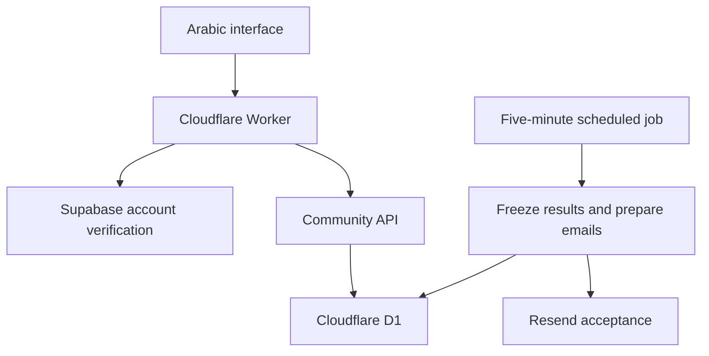

# Architecture and file map

This guide describes the current implementation. It separates presentation, account verification, application data and background work so a new maintainer can follow one feature at a time.

## Request flow

Maintenance currently stops application requests before the normal flow. The scheduled job also returns before touching D1 or the email provider. Only exact logo/favicon/font reads bypass the pause.

## Read the site in this order

1. `app/page.tsx` mounts the main interface in `app/innovation-app.tsx`.
2. `lib/weekly.ts` defines the calendar and content. `currentChallenge()` follows real time. There is no pinned review week.
3. `app/api/community/route.ts` verifies the account, checks the operation and calls the database helpers.
4. `lib/community-read.ts` chooses a displayed/archive week, loads paged data and selects live or frozen ranking rows.
5. `lib/weekly-db.ts` totals genuine likes and saves closed-week rankings atomically.
6. `worker.ts` runs the five-minute background job when maintenance is disabled. Email sending also requires its own enabled flag.

## Feature map

| Feature | Main files | Important boundary |
| --- | --- | --- |
| Sign-in | `app/login/page.tsx`, `lib/auth-client.ts`, `lib/auth-server.ts` | The server verifies the token with Supabase. Browser-supplied account IDs are not trusted. |
| Main navigation and forms | `app/innovation-app.tsx` | The interface guides users, but server checks enforce ownership and deadlines. |
| Challenge content | `lib/weekly.ts`, `lib/weekly-content.ts` | Stable IDs link submissions, drafts, results and email records. |
| Text and warning-icon UI | `app/weekly-challenge-view.tsx`, `app/warning-challenge-visuals.tsx` | Shared challenge layout with theme-specific illustrations. |
| Timed packaging UI | `app/packaging-challenge.tsx`, `lib/packaging-game.ts` | The embedded drawing activity reports a result to the parent page. |
| Community reads | `lib/community-read.ts` | Contributions/images require sign-in. Rankings can be read by guests. |
| Contributions and votes | `app/api/community/route.ts` | Same-origin checks, validated input, ownership and database-clock cutoffs. |
| Drawing images | `lib/drawings.ts`, `lib/drawing-policy.ts`, `app/api/drawing/route.ts` | Small raster images, authenticated reads and no-store responses. |
| Opening ribbons | `lib/opening.ts`, `lib/weekly-opening.ts`, `app/opening-gate.tsx` | Anonymous browser visitors can cut once per event token. |
| Winner emails | `lib/weekly-email.ts`, `lib/weekly-email-template.ts` | Frozen results, verified account email and repeat protection. |
| Maintenance | `lib/site-settings.ts`, `lib/maintenance.ts`, `lib/maintenance-page.ts`, `worker.ts` | One manual switch blocks the app/API and scheduled work. |

## Maintenance boundary

`worker.ts` checks maintenance before calling the framework. Pages receive the new branded HTML with HTTP 503. API calls and non-read methods receive JSON 503. Responses are not cached. The cron exits without finalization or email work.

The setting has no expiry date or public override. See [maintenance operations](maintenance.md) for reopening and the independent email switch.

## Database records

D1 is the application database. Supabase Auth is a separate account service.

| Table | What it stores |
| --- | --- |
| `profiles` | Verified account ID, display name and its normalized uniqueness key |
| `ideas` | Challenge/angle ID, author ID, title, short explanation and creation time |
| `idea_drawings` | One small raster drawing and its revision hash for an idea |
| `comments` | Discussion entries linked to ideas and verified authors |
| `reactions` | One like state per idea/account pair |
| `weekly_results` | Frozen participant totals and rank per closed week |
| `finalized_weeks` | Marker preventing a week from being finalized twice |
| `weekly_email_deliveries` | Private outgoing-email jobs, retry state and provider receipts |
| `opening_events`, `opening_visitors`, `opening_cuts` | Ribbon targets, anonymous browser tokens and accepted cuts |
| `d1_migrations` | Applied migration ledger |
| `launch_test_archive_*` | Retired pre-launch activity, preserved separately from official participation |

`db/schema.ts` describes the Drizzle application schema. The SQL migrations and specialized runtime schema helpers also define auxiliary tables such as the outbox and ribbon records. Do not assume one file alone is a complete database export.

Migrations `0003` and `0005` contain historical cleanup/archiving. They are guarded by recorded migration names. Do not delete the production ledger or replay old cleanup manually. A portal data move needs an explicit mapping and a verified backup first.

## Supporting folders

- `components/ui/` contains reusable UI building blocks. Only components referenced by the current application remain.
- `public/` contains the club logo, favicon and Arabic fonts. Font and third-party licence text should remain intact.
- `scripts/deploy-independent.mjs` is the operator deployment script. `vendor/` retains licensed styling. The active build configuration is `vite.config.ts`.
