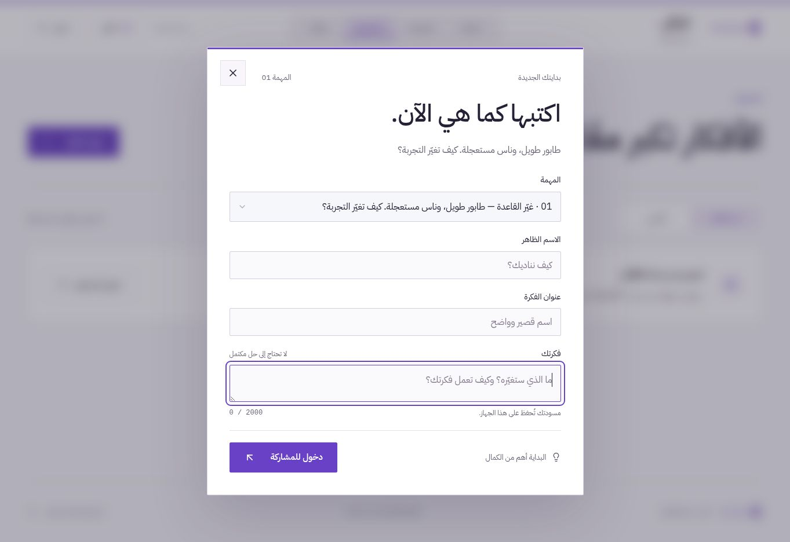

# Community interaction check — 21 September 2026

## Fixed behavior

- The community's Share idea button opens the composer directly. Its mission selector switches between the three challenges and preserves a separate draft for each.
- Creating or editing an idea opens the confirmed result in the current view. It does not navigate to another tab to imply success.
- Comments and reactions use the state returned by the successful write, without a second fetch being necessary to display it.
- Sign-in links retain the current view and idea/composer context. Idea, edit, and comment drafts are saved on the device. No participation is automatically submitted after sign-in.
- Expired sessions preserve input and show the appropriate sign-in link. Failed saves preserve input for retry. Duplicate request IDs cannot silently claim different content was saved.
- Guests see an explicit sign-in state instead of a misleading empty community or personal progress. Tab navigation supports Back and Forward.

## Automated verification

Run `npm run test:community` with Node 24. The 13 checks call the real route handlers with isolated test identities and an in-memory SQLite database created from the actual migration. They cover:

- Guest access, payload validation, malformed JSON, oversized bodies, and cross-origin rejection.
- Creating, reading, author-only editing, idempotent retries, and conflict detection.
- Two-participant encouragement/undo and comments, without leaking account identifiers.
- XP for distinct challenges and distinct other-person ideas; no extra points for edits or repeated comments.
- Recovery when the write succeeds but the response read fails.
- Older owned ideas and their comments beyond the latest 100 community ideas.
- Safe sign-in destinations and corrupted-draft recovery.

## Browser verification

The managed preview checked the real guest interface and a temporary, isolated UI fixture for signed-in responses. The fixture never changed production data or authentication and was removed before the build.

Confirmed direct composer opening, mission selection, restored drafts, in-place publication and editing, encouragement/undo, comments, personal filtering, confirmed-save XP display, failed-save retry, and expired-session recovery. The composer fits a 320-pixel phone viewport without horizontal overflow. Browser checks were paired with the real route/SQLite tests rather than treating fixture responses as backend verification.

## Launch boundary

The current Site is owner-only. Community access must be configured for a user-selected audience before other students can use it. Real hosted ChatGPT sign-in was not exercised by the managed preview; the dispatch-owned sign-in path and application return behavior were checked separately. A real invited participant should complete the first hosted sign-in and participation check after the audience is selected.

The community shows the latest 100 ideas plus all of the current participant's own ideas. No schema or gamification rules changed in this update.

